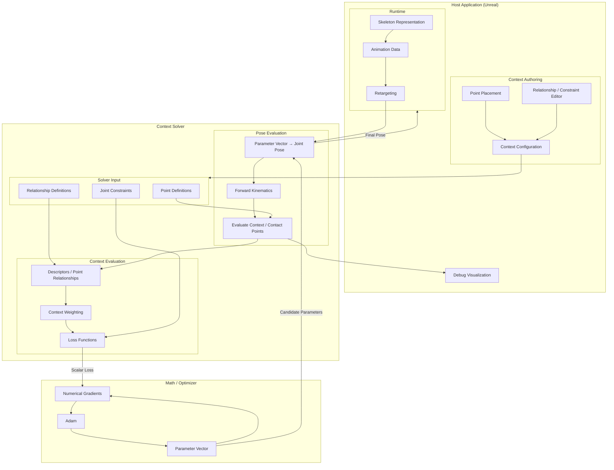

When the source context point is far from other point, there is no reason to make the target reproduce that exact relationship. As the source point approaches the other point, the relationship gradually activates.
This is called adaptive weighting, and is also a reason why adding context points in space and not only on the mesh is important.

One limitation in the paper’s evaluation is that it measures smoothness using the jerk of joint positions. A bone can twist visibly while its joint position barely changes, so their metric could miss exactly this kind of rotational jitter. They report smooth output, but they do not report a bone-orientation jerk metric or discuss twist ambiguity.

normal or orientation only used by penetration currently.

When only hands, face, shoulder context point i noticed a lot of jitter in neutral pose. I solved it by adding more context points.

Relationships on same bone context points are ignored.

We bind context points to bones and not vertices.

Direction should not currently be used for permanently adjacent structural relationships such as:
- chest ↔ upper arm
- upper arm ↔ elbow
- forearm ↔ wrist
Those relationships are always close, so adaptive proximity treats them as important interactions even in the resting pose. Distance can remain enabled for them.

note that frames are nearly independent except for the smoothness loss (also in reconform paper)

The differences caused by windows are mainly:
- Some jerk stencils are missing at window boundaries.
- Overlap frames are solved more than once.
- Independently solved corrections are blended through the overlap.
- Adam’s state restarts for each window.

To fix jerk we:
- stronger point-position regularization;
- stronger jerk regularization;
- smaller Adam learning rate;
- more iterations.

Face context ellipsoid, or mesh patches?
mesh patches, but they are kind of slow right now. So we are optimizing it.

What about another approach:
- We define many points on the face and we check for contact moments with these points (maybe hitboxes).
- On contact moment we force the retargeted motion to also contact its coinciding point by weighting hard? Or use IK and we move the hand using adam to reach that location. Can we maybe keyframe method like how we usually do keyframing? 
- We somehow need to smooth towards that position.

1. Find worst penetration moment and finger that causes it.
2. Find contact location point on source mesh for the finger and get same point on target avatar
3. Use IK to move hand to correct location based on the contact point and finger, using ADAM

This method is what i do when i would correct by manually. I basically define 4 timings:
1. Start of movement
2. Worst penetration moment
3. End of hold of the position
4. End of movement (return to rest or to next movement)
On timing 1 and 4 i zero key, on timing 2 and 3 i key the changes.
If this issue is followed directly by another issue where i have to move the hand, i skip the zero on timing 4 because timing 2 will define where the hand has to be on the following movements.

We have a new library made by a colleague to segment handshapes. But perhaps we can extend on that to segment on fingers but also on arm movement.
Combining all these points we can do the following for fixing collision, using a layered animation approach (just like how we would do it in unreal engine):
1. Find all penetration moments, combine penetration moments that are neighbouring frames in the animation and for each penetration moment:
	1. Find worst penetration frame in moment and finger that causes it (usually the finger and arm movements are the lowest at that point due to the sign being held for a small time).
	2. Find contact location point on source mesh for the finger and get same point on target avatar
	3. Use IK to move hand to correct location based on the contact point and finger, using something like ADAM to find this. Keyframe that moment and use the same key-transform on the end of the penetration moment.
	4. Find the start of the segment the penetration moment belongs to using my colleagues algorithm and place a zero keyframe. This makes the leading movement to the issue move to the new location.
	5. If the following segment does not have a penetration moment:
		1. 